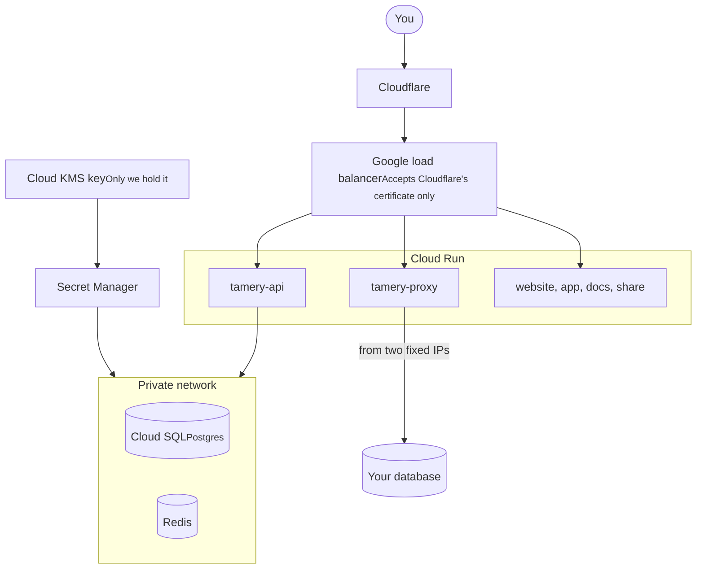

On November 5 we switched Tamery off Railway and onto Google Cloud Run. Two weeks earlier, Railway told every customer to rotate their secrets after someone got into customer environment variables. Tamery holds connection strings to people's production databases, so I wasn't willing to keep those secrets on a platform where that could happen again.

I'm Valerii, and I built most of Tamery. This post covers what happened at Railway, how the new setup works, and what it cost us.

## What happened at Railway, and why it mattered for us

On October 22, Railway disclosed that an unauthorized party may have accessed customer environment variables. That's where apps keep API keys and database passwords. Railway paused all deployments and asked all users, not only the affected ones, to revoke and rotate their keys.

In early November there was a second story. A company called Primcloud said a Railway engineer's AI agents had probed its systems. Railway's CEO apologized publicly.

I don't want to pile on. Running a cloud platform is hard, and I'm sure the people there are having a rough month.

Tamery is different from most apps on a platform like that, though. You point it at your databases. Our servers keep encrypted connection strings and the keys that decrypt them, for people who trust us with production data. For a to-do app, "your platform might have leaked your environment variables" is a bad week. For us, it could mean someone else's database gets dumped.

I want you to trust Tamery with your database credentials the way you trust 1Password with your passwords. That's the bar, and a platform that can leak our secrets makes it impossible to reach.

## The alternative we didn't pick

The fast fix was another platform that runs your containers for you. We could have moved in a day.

It would also have left us where we started, with our secrets in someone else's dashboard behind access controls we can't see or audit. So we went one level lower, to Google Cloud. There we decide who gets access, we hold the encryption key, and every read of a secret ends up in a log we watch.

This has a real cost. Railway let us deploy without thinking about networks, IAM or certificates. Now the whole setup is about 1,000 lines of OpenTofu that we own and have to keep correct.

## How Tamery runs on Google Cloud now

Here is the whole thing, from your browser to our database:

Only Cloudflare can reach our servers, the database sits on a private network and accepts only encrypted connections, and the cloud proxy is firewalled off from that network.

### Only one person can get in

The whole infrastructure has exactly one human way in: a single Google account. There are no shared team logins, and nobody keeps admin rights "just in case".

Everything else is a machine with a narrow job:

- **Each service has its own identity.** The API, the cloud proxy, background jobs and deploys each run as a separate service account with only the permissions that job needs. We also removed Google's default service account's broad Editor role.
- **Each service can read only its own secrets.** The proxy can't read the API's secrets, and the API can't read the proxy's.
- **Deploys hold no keys.** GitHub Actions proves to Google which repository is deploying through Workload Identity Federation, and only `wannabespace/tamery` is allowed to. There's no deploy token to steal.

### We hold the encryption key for every secret

Before, our secrets lived in Railway and in a separate secrets service. Now they're in Secret Manager, encrypted with our own key in Cloud KMS.

That's one fewer company in the chain that has to get everything right. It also means every use of that key gets recorded.

## An AI review of the whole codebase before the move

AI makes it cheap for attackers to look for holes everywhere at once, and that worries me too. But it works the other way as well. Before the move, we used AI to review all of Tamery, code and infrastructure, and fixed what it found. Some of the results:

- **Connection strings stay out of logs and session replays.**
- **Stronger sign-in**, with passkeys, a passkey as your second factor, and an email when something sensitive changes on your account.
- **New npm releases wait three days** before we install them, so a hijacked version is usually pulled before it reaches us.

AI also helped us write the new setup as code and plan the cutover, which is why most of you didn't notice the move on November 5. It doesn't prove the code is secure, but it's a tireless extra reviewer.

## What it cost us

By our early estimate, hosting now costs about three times what we paid Railway, roughly 200% more. Fixed outbound IPs, a load balancer, a private network and managed Postgres and Redis all cost money, and Railway bundled most of that away.

We're fine paying it. Your database credentials are the one thing we can't afford to lose, and this is the price of keeping them on infrastructure we control.

## FAQ

### Was Tamery affected by the Railway breach?

Railway said the breach appeared limited to a subset of users and asked everyone to rotate their keys anyway. We moved every secret to keys we hold on Google Cloud.

### Where is Tamery hosted now?

On Google Cloud Run, with Cloud SQL for Postgres and Memorystore for Redis on a private network, behind Cloudflare.

### Do I need to update my database firewall?

Only if it allows specific IPs. The cloud proxy now connects from `35.246.231.22` and `34.40.119.38`, and you should add both.

### Does Tamery store my database password?

Only if you choose **Full** sync, and only so your other devices can get it. We store it encrypted, nobody at Tamery looks at it, and it's kept out of our logs. With **No password** or **Metadata only**, the password never leaves your device.

---

If you have a question about any of this, or you find something that looks wrong, write to me. I read every message, and security reports go to the top of the pile.

Valerii
